  

<picture>
  <source media="(prefers-color-scheme: dark)" srcset="https://raw.githubusercontent.com/enricmasella/enricmasella/pacman-output/galaga-contribution-graph-dark.svg">
  <source media="(prefers-color-scheme: light)" srcset="https://raw.githubusercontent.com/enricmasella/enricmasella/pacman-output/galaga-contribution-graph.svg">
  
</picture>

 

  

---

## 🛠️ Stack Tecnológico

| Categoría | Tecnologías | Para qué / Estado |
|-----------|-------------|-------------------|
| **Frontend** | HTML5, CSS3, JavaScript | Maquetación y lógica de cliente |
| **Frontend (aprendiendo)** | React, Vue | Componentes y SPA |
| **Backend** | PHP, Symfony | Lógica de servidor y APIs |
| **Bases de datos** | SQL, NoSQL | Almacenamiento relacional y no relacional |
| **DevOps** | Apache, Docker | Despliegue de servidores web y contenedores |
| **Control de versiones** | Git, GitHub, GitHub Actions | Código, repositorio y CI/CD |
| **AI-Assisted Workflow** | OmniRoute, OpenCode, Hermes, Claude Code, GPT, Gemini | Orquestación de modelos, agentes de coding, autocompletado, revisión de código y aprendizaje continuo |

### 🤖 Herramientas de IA que uso

| Herramienta | Para qué sirve |
|-------------|----------------|
| **OmniRoute** | Enrutador de modelos de lenguaje mediante gateway local (OmniRoute) |
| **OpenCode** | Agente de coding autónomo para desarrollo y revisión de código |
| **Hermes** | Orquestador de agentes y habilidades para automatizar flujos de desarrollo |
| **Claude Code** | Asistente de código avanzado para programación, refactorización y debugging |
| **GPT** | Generación de código, documentación y resolución de dudas técnicas |
| **Gemini** | Análisis de código, razonamiento técnico y asistencia en desarrollo |

---

## 🔮 Próximos Proyectos & Roadmap

Proyectos personales, plataformas web y herramientas que estoy diseñando y desarrollando activamente.

| Proyecto | Descripción | Tipo | Estado |
|----------|-------------|------|--------|
| **[uni](https://github.com/enricmasella/uni)** | Suite de herramientas gratuitas para estudiantes de selectividad (PAU): cálculo de notas, ponderaciones, notas de corte, simulador de acceso y utilidades de estudio. | Web Platform (Next.js 16, PostgreSQL) | 🚧 En desarrollo |
| **[NK_Chess](https://github.com/enricmasella/NK_Chess)** | Plataforma de ajedrez educativo interactivo: cursos con estudios dinámicos y ejercicios autocorregibles sin backend ni cuentas. | Web App (React, Vite, chess.js) | 🚧 En desarrollo |
| **[SnapRoulette](https://github.com/enricmasella/SnapRoulette)** | Party game multijugador en tiempo real con salas privadas donde adivinar el autor de fotos y vídeos antes de que desaparezcan. | Real-time Multiplayer (Node.js, Socket.IO) | 🚧 En desarrollo |
| **[NK_Terminal_v2](https://github.com/enricmasella/NK_Terminal_v2)** | Extensión de productividad (Manifest V3): nueva pestaña estilo terminal retro, dashboard interactivo con IA y widgets de sistema. | Chrome Extension | 🧪 Prototipo |
| **[portfolio_NK](https://github.com/enricmasella/portfolio_NK)** | Portfolio web interactivo con animaciones fluidas, scroll cinemático y elementos 3D. | Web 3D (Three.js, Lenis) | 🚀 Próximamente |
| **[Nothing_NK](https://github.com/enricmasella/Nothing_NK)** | Exploración y guía técnica de arquitectura de componentes para dispositivos Nothing. | Android (Kotlin) | 🔬 Experimental |

> 💡 *Proyectos en constante evolución. Los repositorios se publican y actualizan a medida que alcanzan versiones estables.*

---

## 📊 Estadísticas de GitHub

  

  

---

## 🎵 Actualmente escuchando

  

---

## 📫 Conectemos

  
  
  

  

---

<i>Construido con ❤️ y código abierto por <a href="https://github.com/enricmasella">Enric Masella</a>.</i>

